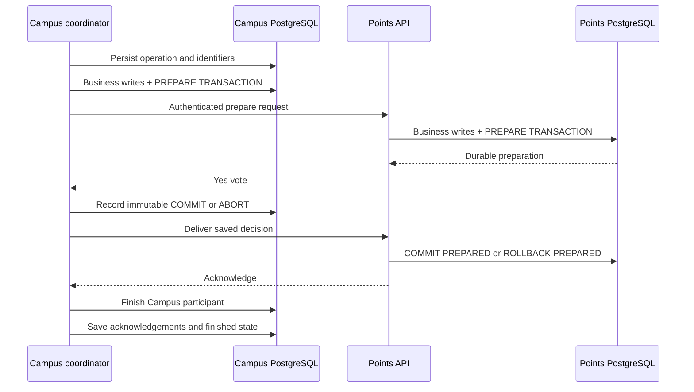

# Two-phase commit

## Which actions participate?

| Operation | Campus preparation | Points preparation |
| --- | --- | --- |
| `create_request` | Insert moderated request | Debit available balance, create held escrow and hold ledger entry |
| `create_response` | Insert moderated response | None; uses the coordinator with Campus as its only participant |
| `accept_response` | Complete request and record selected response/time | Release escrow, credit contributor, add +1 reputation and reward ledger entry |
| `expire_request` | Mark request expired | Refund requester, settle escrow, insert refund ledger entry |

Administrator awards reuse `accept_response`; administrator refunds reuse
`expire_request`. Classifying a request as `conflicted` uses a normal Campus
transaction because it makes no Points changes. Registration wallet
initialization is the separate idempotent local-commit flow described above.

## Prepare, decide, and deliver

1. **Persist intake.** Campus commits the operation's UUID, caller, idempotency
   key, and trusted payload to `distributed_transactions`. Before preparation,
   the coordinator reserves any new entity IDs durably and registers the
   required participants.
2. **Prepare local work.** Each participant validates its inputs and eligibility
   under locks, performs its business writes, inserts a local journal row, and
   executes PostgreSQL `PREPARE TRANSACTION` on a dedicated connection. It votes
   Yes only after preparation is durable. Ordinary ORM sessions do not finish
   these native transactions.
3. **Record one decision.** Campus records COMMIT only after all required Yes
   votes. A failed prepare or unconfirmed prepare reply causes ABORT. The
   decision is persisted before delivery and cannot be replaced later.
4. **Deliver the decision.** Campus sends the saved decision to participants,
   delivering to Points before completing its own participant. Participants
   verify Campus's recorded decision before applying `COMMIT PREPARED` or
   `ROLLBACK PREPARED`.
5. **Finish acknowledgement.** Campus records each acknowledgement and marks
   the coordinator operation `finished` only after all participants acknowledge.
   The API exposes the completed business result at that point.



This diagram shows a two-participant action. Response creation uses the same
coordinator without a Points participant.

## Durable state and duplicate protection

| Record | Location | Purpose |
| --- | --- | --- |
| `distributed_transactions` | Campus database | Operation payload, caller, key, entity IDs, immutable decision, progress and error |
| `transaction_participants` | Campus database | Required services, Yes/No votes, acknowledgements |
| `participant_transactions` | Each service's database | Local native transaction ID and prepared/committed/aborted journal state |
| `pg_prepared_xacts` | PostgreSQL system view | Native preparations that survived disconnection or process restart |
| `escrows`, `points_transactions` | Points database | Held/released/refunded rewards and financial ledger |

Coordinator progress follows:

```text
preparing -> commit_decided -> finished  (decision: commit)
preparing -> abort_decided  -> finished  (decision: abort)
```

Public results translate these records into `processing`, `completed`, or
`aborted`. The `finished` coordinator state alone does not imply success; inspect
its decision.

Native transaction IDs have the form
`campuspoint:<service>:<transaction-UUID-hex>:<payload-hash>`. The hash binds retries
to the same validated message even before its journal row becomes visible.
Advisory locks serialize coordination and participant messages per operation.
Request, response, wallet, and escrow row locks protect eligibility and accounting
across different operation IDs.

Unique constraints enforce one response per contributor/request, one escrow per
request, and one opening grant per user. Partial unique indexes prevent multiple
reward or refund entries per escrow and duplicate active/committed expiry jobs.
Escrow status checks prevent a released or refunded hold from being settled again.
Abort journal records also reject delayed prepare messages after an abort.

## Visibility and availability

Prepared business writes are not visible to normal readers, but retain database
locks. List/detail reads additionally require a finished committed creation
operation before publishing a new request or response.

Decision delivery can commit one participant before the other. Independent
reads may temporarily observe that service's committed state while the operation
is still processing. Clients must wait for coordinator completion before claiming
that an award or refund finished.

A recorded COMMIT must eventually finish as COMMIT, even after a deadline passes
or an acknowledgement is lost. During an outage, a prepared participant can
remain blocked until the coordinator and communication recover. A timeout never
authorizes an independent participant to reverse the decision.

Next: [recovery workers](recovery.md).
